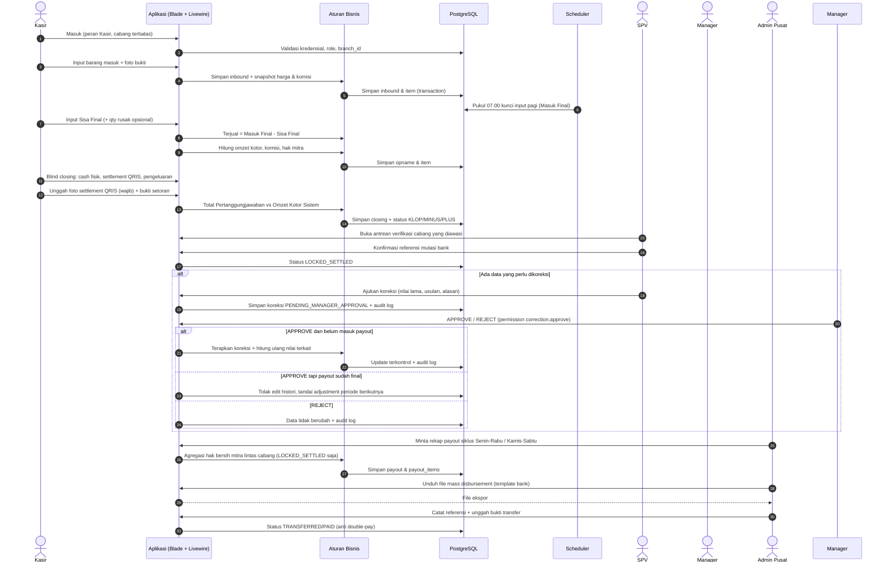
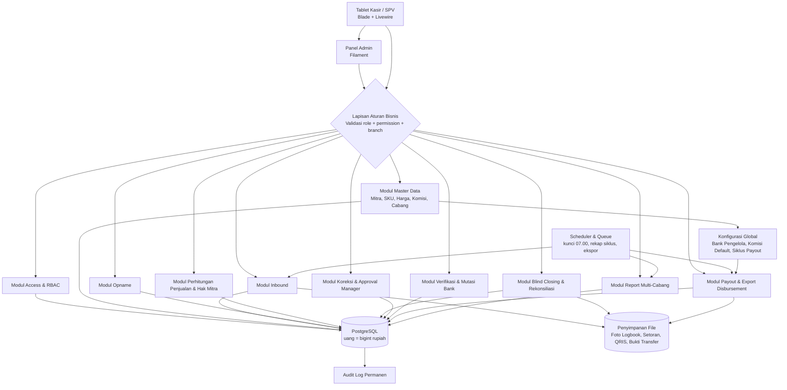

# PRD — Project Requirements Document

**Produk:** ERP Lapak Sepuluh (L10)
**Versi dokumen:** 2 — revisi berdasarkan konfirmasi requirement terbaru klien
**Status:** Requirement MVP terkonfirmasi; sisa ketidakpastian dicatat di §2.5 Open Questions
**Sifat revisi:** pembaruan in-place atas PRD versi 1. Requirement versi 1 yang masih relevan dipertahankan; keputusan teknis yang tidak berkaitan tidak diubah.

---

## 1. Overview

**Lapak Sepuluh (L10)** adalah bisnis distribusi dan penjualan makanan dengan model **konsinyasi**: produk milik mitra UMKM dititipkan di cabang L10, dijual, lalu mitra menerima hak bayar setelah dipotong komisi admin.

Saat ini operasional cabang masih berjalan di atas spreadsheet manual. Pola kerjanya sebenarnya sederhana dan berulang setiap hari — barang masuk pagi, barang sisa dihitung siang, uang disetor sore — tetapi karena dicatat manual, muncul beberapa masalah yang terus berulang:

1. **Rawan salah hitung.** Selisih antara stok masuk, stok sisa, dan uang setoran sering baru ketahuan belakangan, setelah data terlanjur ditumpuk.
2. **Koreksi tidak bisa diaudit.** Ketika angka diubah, tidak ada catatan siapa yang mengubah, kapan, dan alasannya.
3. **Rekap mitra manual.** Hak bayar setiap mitra harus dihitung ulang satu per satu setiap periode pencairan.
4. **Pengawasan cabang tidak terpusat.** Owner dan Admin Pusat tidak punya satu layar untuk melihat performa dan selisih kas semua cabang.
5. **Sulit berkembang.** Struktur spreadsheet tidak siap menampung penambahan cabang hingga sepuluh cabang.

### 1.1 Konteks Operasional yang Mempengaruhi Desain

Beberapa kondisi lapangan berikut sudah dikonfirmasi klien dan **wajib menjadi asumsi dasar desain**:

- **Tidak ada POS.** L10 tidak mencatat transaksi pembeli satu per satu. Karena itu sistem **tidak boleh mengasumsikan** mengetahui nilai penjualan tunai dan nilai penjualan QRIS secara terpisah. Angka penjualan diturunkan dari **stok opname** (stok masuk final dikurangi stok sisa final), bukan dari transaksi kasir per pembeli.
- **Pembayaran QRIS bersifat settlement agregat.** Pada MVP tidak ada integrasi payment gateway. Nilai QRIS yang diterima adalah **satu angka settlement** yang diinput manual oleh Kasir saat blind closing, disertai **foto bukti laporan settlement QRIS**.
- **Target operasional 10 cabang, saat ini 1 cabang beroperasi.** Struktur data, peran, permission, laporan, dan workflow harus **sudah mendukung 10 cabang sejak MVP**, meskipun implementasi dan UAT dilakukan bertahap.
- **Pencairan mitra dilakukan manual.** Belum ada auto-disbursement API. Sistem berhenti pada perhitungan hak bersih mitra dan penghasilan **file rekap/ekspor mass disbursement** sesuai template bank pengelola.
- **Seluruh mitra memakai bank yang sama dengan pengelola L10.** Nama bank final belum dikonfirmasi sehingga menjadi konfigurasi Admin Pusat dan Open Question.

### 1.2 Tujuan Utama Aplikasi

- Menyediakan satu sistem terpusat untuk mencatat barang masuk, menghitung barang terjual dari stok opname, dan menutup kas harian.
- Menghilangkan salah hitung melalui perhitungan otomatis, pembatasan input, dan rekonsiliasi yang eksplisit.
- Menyediakan mekanisme koreksi berjenjang (**SPV mengajukan → Manager menyetujui/menolak**) dengan jejak audit yang jelas.
- Menghasilkan rekap hak mitra lintas cabang dan file transfer massal secara otomatis dari data yang sudah terkunci.
- Menyiapkan fondasi multi-cabang sejak awal, tanpa membangun sistem yang berlebihan untuk satu cabang yang aktif hari ini.

### 1.3 Ringkasan Keputusan Resmi Klien (Confirmed)

| # | Area | Keputusan Terkonfirmasi |
|---|---|---|
| 1 | Harga produk | Hanya **Rp10.000** dan **Rp15.000**. Rp12.000 adalah data historis, tidak berlaku untuk transaksi baru. |
| 2 | Komisi L10 | **Rp1.500 per produk terjual** saat ini; dapat dinaikkan (mis. Rp2.000) atau diubah nominalnya melalui pengaturan Admin Pusat. |
| 3 | Efektivitas perubahan harga/komisi | Hanya berlaku untuk **transaksi baru** sesuai tanggal efektif; perubahan harga/SKU mengikuti approval Admin Pusat dan **efektif H+1**. |
| 4 | Snapshot | Setiap transaksi **wajib** menyimpan snapshot harga dan komisi agar histori tidak berubah. |
| 5 | QRIS | Tanpa payment gateway. Settlement diinput manual + foto bukti wajib. Rekonsiliasi dilakukan terhadap omzet hasil opname. |
| 6 | Pengeluaran operasional | Menjadi beban L10; **tidak mengurangi hak bersih mitra**. |
| 7 | Koreksi setelah closing | Diajukan **SPV**, disetujui/ditolak **Manager** (maker-checker). SPV tidak boleh mengubah data terkunci secara sepihak. |
| 8 | Payout | Tanpa auto-disbursement API. Siklus **Senin–Rabu** dan **Kamis–Sabtu**, digabung lintas cabang, hanya transaksi `LOCKED_SETTLED`. Transfer manual via fasilitas mass disbursement bank. |
| 9 | Multi-cabang | Sistem harus siap untuk 10 cabang sejak MVP; saat ini 1 cabang aktif. |
| 10 | Rumus stok | **Terjual = Masuk Final − Sisa Final**. Barang rusak/basi yang belum terjual masuk sebagai bagian stok sisa, tidak dikurangkan dua kali. |

**Prinsip pengembangan:** bangun **Core ERP yang ringkas dan benar** dulu (operasional harian → verifikasi → koreksi → pencairan → laporan), lalu perluas ke modul pendukung (absensi, payroll, auto-disbursement, AI) setelah alur inti terbukti dipakai. AI **tidak boleh** menjadi dependency wajib pada proses finansial MVP.

---

## 2. Requirements

### 2.1 Persyaratan Fungsional Utama

1. **Manajemen master data terpusat** — mitra, produk/SKU, harga, komisi, dan penempatan produk per cabang dikelola hanya oleh Admin Pusat.
2. **Pencatatan barang masuk harian** oleh Kasir per cabang, dengan bukti foto, dan **terkunci otomatis** setelah jam operasional pagi berakhir.
3. **Perhitungan barang terjual otomatis** dari `Masuk Final − Sisa Final`, tanpa input transaksi per pembeli. Barang rusak dicatat sebagai klasifikasi, bukan pengurang ganda.
4. **Penutupan kas harian (blind closing)** dengan input terpisah: uang fisik, settlement QRIS manual, pengeluaran tunai sah, serta unggah bukti setoran dan foto laporan settlement QRIS.
5. **Rekonsiliasi dan penentuan status selisih** (KLOP / MINUS / PLUS) menggunakan formula resmi yang sama untuk seluruh cabang.
6. **Verifikasi closing & konfirmasi mutasi bank** oleh SPV/Manager sehingga closing berstatus `LOCKED_SETTLED` sebelum boleh masuk payout.
7. **Koreksi maker-checker setelah closing** — SPV mengajukan, Manager menyetujui/menolak; sistem menerapkan koreksi secara terkontrol dengan perhitungan ulang dan audit log.
8. **Perhitungan hak mitra otomatis** (omzet − komisi) per produk, per cabang, per periode, dengan snapshot nilai.
9. **Rekap payout tiga harian** (Senin–Rabu, Kamis–Sabtu) yang menggabungkan pendapatan mitra dari seluruh cabang yang sudah settled.
10. **Ekspor mass disbursement** sesuai template bank pengelola, dengan pencatatan bukti & referensi transfer serta proteksi pembayaran ganda.
11. **Dashboard dan laporan multi-cabang** untuk Owner/Manager/Admin Pusat: performa cabang, selisih kas, dan ekspor laporan.
12. **Audit log permanen** untuk seluruh perubahan penting (harga, komisi, koreksi, approval, payout, verifikasi) dan **migrasi data** dari spreadsheet existing.
13. **Hak akses berbasis peran dan cabang**, divalidasi di backend (bukan sekadar menyembunyikan menu): Kasir, SPV, Manager/Owner, Admin Pusat.

### 2.2 Business Rules Terkonfirmasi (Confirmed Requirements)

> Aturan pada bagian ini **menggantikan** asumsi versi 1 yang bertentangan. Setiap aturan bersifat normatif untuk implementasi.

#### 2.2.1 Harga dan Komisi

- Harga jual resmi hanya memiliki **dua pilihan: Rp10.000 dan Rp15.000**. Nilai Rp12.000 pada spreadsheet lama adalah **data historis** dan tidak boleh dipakai untuk transaksi baru.
- Komisi L10 saat ini **Rp1.500 per produk terjual**. Komisi dapat dinaikkan menjadi Rp2.000 atau nominal lain pada masa depan **melalui pengaturan Admin Pusat** (konfigurasi, bukan hardcode).
- Perubahan harga atau komisi **hanya berlaku untuk transaksi baru** sesuai tanggal efektif. Transaksi yang sudah tercatat tidak boleh berubah nilainya.
- Perubahan harga/SKU mengikuti **approval Admin Pusat** dan **efektif H+1** sesuai SRS.
- Seluruh transaksi (barang masuk, opname, payout) **wajib menyimpan snapshot** harga dan komisi pada saat transaksi terjadi.
- Harga dan komisi tidak boleh ditulis sebagai konstanta di kode program; keduanya data terkonfigurasi dengan riwayat (`product_prices`) dan jejak approval (`price_change_requests`).

#### 2.2.2 Pembayaran QRIS dan Rekonsiliasi Kas

- Pada MVP, pembayaran QRIS **tidak memerlukan integrasi payment gateway**.
- Kasir **menginput total settlement QRIS secara manual** saat blind closing.
- Kasir **wajib mengunggah foto laporan settlement QRIS** sebagai bukti.
- Sistem menghitung omzet berdasarkan **barang terjual yang diperoleh dari stok masuk dikurangi stok sisa**.
- Sistem merekonsiliasi **total uang tunai, settlement QRIS, dan pengeluaran operasional yang sah** terhadap omzet hasil stok opname.
- Karena tidak ada POS yang mencatat transaksi pembeli satu per satu, sistem **tidak boleh mengasumsikan** mengetahui nilai QRIS dan tunai masing-masing secara independen. Yang direkonsiliasi adalah **total pertanggungjawaban**, bukan dua selisih terpisah.
- Integrasi QRIS otomatis tetap berada di **Future Roadmap**, bukan MVP.

**Formula resmi (wajib dipakai konsisten di aplikasi, laporan, dan pengujian):**

```
Omzet Kotor Sistem      = Σ (Qty Terjual × Harga Snapshot)

Total Pertanggungjawaban = Cash Fisik + QRIS Settlement + Pengeluaran Tunai Sah

Selisih                 = Total Pertanggungjawaban − Omzet Kotor Sistem
```

**Penentuan status selisih:**

| Kondisi | Status | Makna operasional |
|---|---|---|
| `Selisih = 0` | **KLOP** | Pertanggungjawaban sesuai omzet sistem. |
| `Selisih < 0` | **MINUS** | Uang yang dipertanggungjawabkan kurang dari omzet sistem → perlu penelusuran/approval. |
| `Selisih > 0` | **PLUS** | Uang melebihi omzet sistem → perlu penelusuran (kemungkinan stok sisa salah hitung atau setoran lain). |

- **Pengeluaran operasional merupakan beban L10** dan **tidak boleh mengurangi hak bersih mitra**. Pengeluaran hanya diakui bila sah (memiliki kategori, nominal, keterangan, dan bukti).
- Status MINUS/PLUS **tidak otomatis menutup closing**; penyelesaiannya mengikuti kebijakan approval yang masih berstatus **PROPOSED** (§2.5).

#### 2.2.3 Rumus Stok dan Penanganan Barang Rusak

Rumus resmi:

```
Terjual = Masuk Final − Sisa Final
```

- Barang **rusak atau basi yang belum terjual** dan masih berada di lapak **menjadi bagian dari stok sisa**. Karena itu barang rusak **tidak dikurangkan lagi** dari rumus terjual.
- Apabila diperlukan untuk klasifikasi dan pelaporan, boleh disimpan `qty_damaged` sebagai **informasi tambahan**, dengan ketentuan:

```
0 ≤ Qty Rusak ≤ Qty Sisa
```

- **Dilarang mengurangi Qty Rusak dua kali** (baik sebagai pengurang stok sisa maupun pengurang qty terjual).
- Jika barang **telah terjual** lalu konsumen mengajukan refund, proses diselesaikan melalui **modul komplain/adjustment** sesuai kebijakan, dan **tidak dianggap sebagai barang sisa biasa**.

#### 2.2.4 Koreksi Setelah Closing (Maker–Checker)

Klien mengonfirmasi bahwa koreksi setelah closing dilakukan oleh **Supervisor (SPV)** dengan **persetujuan Manager**.

Workflow wajib:

1. Closing telah **disubmit atau dikunci** (`SUBMITTED` / `LOCKED_SETTLED`).
2. **SPV membuat pengajuan koreksi.**
3. **SPV menentukan data yang ingin dikoreksi** (entitas + field + nilai usulan).
4. Sistem mencatat **nilai lama, nilai usulan, alasan, identitas SPV, dan timestamp**.
5. Status pengajuan menjadi **`PENDING_MANAGER_APPROVAL`**.
6. **Manager dapat `APPROVE` atau `REJECT`.**
7. Jika disetujui, sistem **menerapkan koreksi secara terkontrol** (dalam transaksi database).
8. Sistem **menghitung ulang nilai terkait** apabila memang diperlukan (terjual, omzet, komisi, hak mitra, selisih).
9. **Audit log menyimpan seluruh riwayat** (pengajuan, keputusan, penerapan, nilai sebelum/sesudah).
10. Jika **ditolak**, data transaksi **tidak berubah**.

Batasan penting:

- **SPV tidak boleh mengubah transaksi yang terkunci secara sepihak.** Tidak ada jalur edit langsung pada data `SUBMITTED`/`LOCKED_SETTLED`.
- **Manager harus memiliki permission khusus** untuk approval (`correction.approve`), terpisah dari permission pengajuan (`correction.request`).
- Sistem **wajib mencegah perubahan yang menyebabkan ketidaksesuaian payout**. Koreksi yang berdampak pada payout harus diblokir atau diklasifikasikan, bukan diterapkan diam-diam.
- Jika transaksi **sudah masuk payout final atau sudah dibayar**, histori **tidak boleh diedit diam-diam**. Wajib menggunakan mekanisme **adjustment/reversal terotorisasi pada periode berikutnya**.
- Detail kebijakan adjustment finansial yang belum dikonfirmasi klien ditandai **PROPOSED** dan dicatat sebagai Open Question.

#### 2.2.5 Pencairan Dana Mitra (Payout)

- **Auto-disbursement API belum termasuk MVP.** Sistem cukup menghitung hak bersih mitra dan menghasilkan rekap payout.
- **Siklus payout: Senin–Rabu dan Kamis–Sabtu** (dua siklus per minggu, tiga hari kalender per siklus).
- Rekap **menggabungkan pendapatan mitra dari seluruh cabang** dalam satu periode.
- Transaksi yang **belum `LOCKED_SETTLED` tidak boleh diproses** ke payout final.
- File transfer massal **diekspor sesuai template resmi bank pengelola**.
- Transfer dilakukan **manual** melalui fasilitas mass disbursement bank.
- **Seluruh mitra wajib menggunakan bank yang sama dengan pengelola L10.** Nama bank final belum dikonfirmasi sehingga menjadi **konfigurasi Admin Pusat** dan **Open Question**. Sistem **tidak boleh mengasumsikan** file ekspor kompatibel dengan bank tertentu sebelum format resmi bank tersebut tersedia.
- MVP **tidak perlu** mendukung kalkulasi biaya transfer antarbank.
- Status payout **wajib memiliki pelacakan yang mencegah pembayaran ganda** (state machine + constraint unik).
- **Bukti dan referensi transfer harus disimpan** (nomor referensi bank, file bukti, waktu transfer, pelaku transfer).

#### 2.2.6 Multi-Cabang

- Sistem ditargetkan dapat diterapkan ke **seluruh 10 cabang secara serentak**, tetapi **saat ini baru satu cabang yang beroperasi**.
- Struktur data, role, permission, laporan, dan workflow **harus mendukung 10 cabang sejak MVP**.
- **Setiap Kasir hanya dapat mengakses cabangnya** (satu `home_branch_id`, tanpa akses lintas cabang).
- **SPV dapat mengawasi beberapa cabang** sesuai assignment (`user_branches`).
- **Manager/Owner dan Admin Pusat** memiliki akses sesuai permission masing-masing (bisa lintas cabang).
- **Satu mitra dapat menitipkan produk di beberapa cabang.**
- **Payout mitra menggabungkan hasil penjualan dari seluruh cabang yang sudah settled.**
- UAT menggunakan **satu cabang aktif dan simulasi cabang lainnya**, termasuk pengujian beberapa pengguna bersamaan (lihat §4.8).
- **Go-live serentak tidak boleh dijanjikan** sebelum kesiapan data, perangkat, jaringan, training, dan hasil UAT dinyatakan memenuhi acceptance criteria.

### 2.3 Persyaratan Non-Fungsional

- **Akurasi finansial**: setiap operasi yang menyentuh uang (opname, closing, koreksi, payout, verifikasi) dijalankan dalam **transaksi database** agar tidak ada data setengah jadi.
- **Snapshot harga & komisi**: nilai harga/komisi disalin ke setiap transaksi, sehingga perubahan tarif tidak pernah mengubah riwayat.
- **Nominal uang bertipe integer Rupiah**: seluruh kolom uang disimpan sebagai `bigint` rupiah penuh (tanpa desimal), untuk menghindari galat pembulatan.
- **Audit trail permanen**: log tidak dapat dihapus dari antarmuka pengguna, hanya bisa dibaca.
- **Maker–checker**: aksi finansial sensitif (koreksi, perubahan harga/komisi, payout) tidak boleh diselesaikan oleh satu orang yang sama.
- **Ramah tablet**: tombol besar, alur input singkat, nyaman dipakai layar sentuh di cabang.
- **Cepat di jam sibuk**: input barang masuk (05.00–07.00) dan opname (11.00–11.30) harus selesai dalam hitungan detik per produk.
- **Siap multi-cabang**: semua tabel operasional memiliki `branch_id`; penambahan cabang baru tidak memerlukan perubahan skema.
- **Backup harian** database dan file bukti (foto logbook, bukti setoran, foto settlement QRIS, bukti transfer).
- **Migrasi data aman**: data mitra/SKU dari spreadsheet dibersihkan dulu (SKU kosong & duplikat dirapikan) sebelum diimpor, dengan laporan hasil pemetaan.
- **Tanpa dependency AI** pada jalur finansial MVP.

### 2.4 Scope: MVP, Development Milestone, dan Future Roadmap

Ketiga hal berikut **harus dipisahkan secara tegas** agar tidak terjadi salah tafsir kontraktual.

#### 2.4.1 MVP Scope — 11 Modul Core ERP (seluruhnya termasuk kontrak MVP)

| # | Modul | Termasuk MVP |
|---|---|---|
| 1 | Authentication & Role-Based Access Control | ✅ wajib |
| 2 | Master Data Mitra, SKU, Harga, Komisi & Cabang | ✅ wajib |
| 3 | Inbound Barang | ✅ wajib |
| 4 | Stok Opname | ✅ wajib |
| 5 | Perhitungan Penjualan & Hak Mitra | ✅ wajib |
| 6 | Blind Closing | ✅ wajib |
| 7 | Koreksi SPV & Approval Manager | ✅ wajib |
| 8 | Verifikasi Closing & Konfirmasi Mutasi Bank | ✅ wajib |
| 9 | Rekap Payout & Export Mass Disbursement | ✅ wajib |
| 10 | Dashboard & Reporting Multi-Cabang | ✅ wajib |
| 11 | Audit Log & Data Migration | ✅ wajib |

> **Pernyataan tegas:** Master Data, Authorization, Correction, dan Payout **bukan fitur opsional** dan **tidak berada di luar MVP**. Keempatnya adalah bagian integral dari Core ERP MVP.

#### 2.4.2 Development Milestone (urutan pengerjaan internal, bukan pengurangan scope)

Pembagian ini **hanya** mengatur urutan eksekusi tim; seluruh milestone berada di dalam MVP.

| Milestone | Fokus | Modul yang diselesaikan |
|---|---|---|
| **M1 — Fondasi & Master Data** | Skema, auth, master data, konfigurasi harga/komisi, migrasi awal | Modul 1, 2, 11 (migrasi) |
| **M2 — Operasional Harian** | Inbound, opname, perhitungan terjual/omzet/hak mitra, blind closing | Modul 3, 4, 5, 6 |
| **M3 — Pengawasan & Koreksi** | Verifikasi closing, konfirmasi mutasi bank, koreksi maker-checker, audit | Modul 7, 8, 11 (audit) |
| **M4 — Pencairan & Pelaporan** | Rekap payout tiga harian, ekspor mass disbursement, dashboard multi-cabang, hardening & UAT | Modul 9, 10 |

#### 2.4.3 Future Roadmap (di luar kontrak MVP)

- Absensi dan HRIS
- Payroll
- Auto-disbursement API
- Integrasi QRIS otomatis (payment gateway)
- AI Demand Forecasting
- AI Fraud Detection
- AI Copilot
- Portal Mitra lengkap (self-service)
- Customer Portal
- Aplikasi native (Android/iOS)

**Catatan:** AI dan integrasi perbankan otomatis **tidak menjadi dependency wajib** untuk proses finansial MVP. MVP harus dapat beroperasi penuh secara manual-terkontrol.

**Eksplisit di luar MVP (dipertahankan dari versi 1):** POS konvensional yang mencatat setiap transaksi pembeli, microservices.

### 2.5 Open Questions (belum dikonfirmasi klien)

> Pertanyaan yang sudah dijawab klien pada revisi ini (tier harga, mekanisme QRIS, alur koreksi, periode payout, auto-disbursement, dukungan multi-cabang) **telah dihapus** dari daftar ini dan dipindahkan ke Confirmed Requirements (§2.2). Jawaban **tidak boleh dikarang** untuk butir di bawah.

| # | Pertanyaan Terbuka | Dampak | Status |
|---|---|---|---|
| 1 | **Bank final pengelola L10** (nama bank, format rekening, ketentuan mass disbursement) | Menentukan template ekspor payout dan validasi rekening mitra | OPEN — sementara jadi konfigurasi Admin Pusat |
| 2 | **Kebijakan koreksi setelah payout dibayarkan** (mekanisme adjustment/reversal periode berikutnya, boleh tidak, siapa yang berwenang) | Menentukan aturan `payout_impact` pada koreksi | **PROPOSED** — perlu persetujuan klien |
| 3 | **Kebijakan penyelesaian selisih kas** (MINUS/PLUS): ambang toleransi, siapa yang wajib approve, apakah ditanggung kasir/L10 | Menentukan status lanjutan closing dan kebutuhan approval | OPEN — sebagian **PROPOSED** |
| 4 | **Kebutuhan offline** saat jaringan cabang terganggu (apakah masuk MVP atau cukup perangkat/jaringan cadangan) | Menentukan kompleksitas sinkronisasi | OPEN |
| 5 | **Deadline dan jadwal implementasi final** (termasuk kesiapan 10 cabang) | Menentukan perencanaan rilis & penawaran harga | OPEN |
| 6 | **Kebutuhan dokumen/template ekspor bank** — apakah klien menyediakan file template resmi | Menentukan format kolom ekspor | OPEN — belum boleh diasumsikan |
| 7 | **Kriteria penerimaan dan kesiapan go-live** (checklist data, perangkat, jaringan, training, UAT) | Menentukan gate go-live serentak | OPEN |
| 8 | **Sifat penguncian input pagi**: apakah pukul 07.00 WIB absolut atau ada toleransi/override SPV | Menentukan aturan `locked_at` dan jalur override | OPEN |

---

## 3. Core Features

> Struktur bagian ini mengikuti **11 modul Core ERP MVP** (§2.4.1), bukan lagi pembagian "fase opsional". Urutan pengerjaan internal ada di §2.4.2.

### 3.1 Authentication & Role-Based Access Control `[high]`

Setiap pengguna masuk dengan peran dan batas cabangnya masing-masing, divalidasi di backend.

- **Masuk & Keluar** — Pengguna masuk dengan akun pribadi dan keluar dengan aman setelah selesai bekerja.
- **Akses Sesuai Cabang** — Kasir hanya bisa mengakses cabangnya; SPV dapat mengakses beberapa cabang sesuai assignment; Manager/Owner dan Admin Pusat sesuai permission.
- **Peran Pengguna** — Admin Pusat mengatur peran Kasir, SPV, Manager, Owner, dan Admin Pusat beserta permission granular.
- **Pemisahan Kewenangan** — Permission `correction.request` (SPV) terpisah dari `correction.approve` (Manager); permission `payout.export` terpisah dari `payout.mark_paid`.
- **Penolakan Akses Lintas Cabang** — Percobaan membaca data cabang lain ditolak walau URL ditebak.

### 3.2 Master Data Mitra, SKU, Harga, Komisi & Cabang `[high]`

Data mitra, produk, harga, dan komisi dikelola terpusat dan tidak mengubah riwayat lama.

- **Data Mitra & Rekening** — Admin Pusat mendaftarkan identitas mitra beserta rekening tujuan pencairan (bank wajib sama dengan pengelola).
- **Data Produk/SKU** — Admin Pusat mengelola daftar produk, status aktif, dan kode unik hasil pembersihan spreadsheet.
- **Atur Harga & Komisi** — Harga dibatasi dua pilihan resmi (Rp10.000 / Rp15.000); komisi default Rp1.500 dan dapat diubah melalui pengaturan.
- **Riwayat & Efektivitas** — Setiap perubahan menghasilkan record harga baru dengan `effective_from` (efektif H+1) dan menutup record sebelumnya; histori transaksi tidak tersentuh.
- **Approval Perubahan Harga/SKU** — Perubahan diajukan sebagai `price_change_request` dan dieksekusi setelah disetujui Admin Pusat.
- **Penempatan per Cabang** — Admin Pusat menentukan produk mitra mana yang dijual di cabang mana; satu mitra bisa menitipkan produk di beberapa cabang.
- **Data Cabang** — Pengelolaan data cabang hingga kapasitas 10 cabang, termasuk status aktif/non-aktif.

### 3.3 Inbound Barang `[high]`

Kasir mencatat jumlah barang titipan mitra yang diterima pagi ini dengan cepat dan rapi.

- **Pilih Mitra & Produk** — Kasir memilih mitra lalu melihat daftar produk aktif yang bisa diterima di cabangnya.
- **Input Jumlah Masuk** — Kasir mengisi jumlah barang yang diterima per produk tanpa menghitung ulang manual.
- **Snapshot Harga & Komisi** — Nilai harga/komisi yang berlaku pada tanggal transaksi disalin ke setiap item.
- **Foto Bukti Terima** — Kasir melampirkan foto logbook atau surat serah terima sebagai bukti sah.
- **Kunci Input Pagi** — Input otomatis terkunci setelah jam operasional pagi berakhir agar data tidak diubah sembarangan.
- **Finalisasi** — Data yang sudah dikunci menjadi dasar **Masuk Final** pada opname.

### 3.4 Stok Opname `[high]`

Kasir cukup memasukkan sisa stok fisik, jumlah terjual dihitung otomatis tanpa salah hitung.

- **Daftar Stok Awal** — Sistem menampilkan seluruh produk aktif cabang beserta Masuk Final hari ini.
- **Input Sisa Fisik** — Kasir mengetik sisa stok yang benar-benar ada di rak atau etalase (termasuk barang rusak/basi yang masih di lapak).
- **Catat Barang Rusak (informatif)** — Kasir boleh menandai qty rusak/basi sebagai klasifikasi, dengan aturan `0 ≤ Qty Rusak ≤ Qty Sisa`; nilainya **tidak** mengurangi terjual.
- **Lihat Terjual Otomatis** — `Terjual = Masuk Final − Sisa Final`, ditampilkan per produk dan per mitra.
- **Tanpa Pengurangan Ganda** — Sistem menolak qty rusak yang melebihi sisa dan tidak mengurangkan rusak dua kali.

### 3.5 Perhitungan Penjualan & Hak Mitra `[high]`

Omzet, komisi, dan hak bersih mitra dihitung otomatis dari snapshot.

- **Omzet Kotor Sistem** — `Σ (Qty Terjual × Harga Snapshot)`, ditampilkan per produk, per mitra, per cabang.
- **Komisi Otomatis** — `Σ (Qty Terjual × Komisi Snapshot)` menggunakan komisi yang berlaku saat transaksi.
- **Hak Bersih Mitra** — `Omzet − Komisi`, tidak dikurangi pengeluaran operasional L10.
- **Modul Komplain/Refund** — Pembatalan pasca-jual dicatat sebagai komplain dengan dampak finansial terpisah, bukan sebagai pengurang stok sisa.
- **Rincian per Mitra** — Admin Pusat dapat membuka rincian penjualan dan komisi per produk mitra.

### 3.6 Blind Closing `[high]`

Kasir menutup buku harian dengan setoran dan bukti kas yang tercatat jelas.

- **Blind Closing** — Kasir menghitung uang fisik lebih dulu tanpa melihat angka sistem agar hasilnya jujur.
- **Input Cash Fisik** — Total uang tunai yang dihitung dimasukkan sebagai satu angka.
- **Input Settlement QRIS Manual** — Kasir memasukkan **total settlement QRIS** (satu angka agregat) — bukan per transaksi.
- **Foto Bukti Settlement QRIS** — Wajib unggah foto laporan settlement; closing tidak bisa disubmit tanpa bukti.
- **Pengeluaran Operasional Sah** — Kasir/SPV mencatat pengeluaran tunai sah (kategori, nominal, keterangan, bukti) sebagai beban L10.
- **Upload Bukti Setoran** — Bukti setoran tunai dilampirkan sebagai bagian penutupan.
- **Ringkasan Rekonsiliasi** — Sistem menampilkan Omzet Kotor Sistem, Total Pertanggungjawaban, Selisih, dan status **KLOP / MINUS / PLUS** sebelum menutup hari.
- **Batasan Pengetahuan Sistem** — Sistem tidak menampilkan/mengasumsikan split tunai vs QRIS per transaksi; yang dibandingkan adalah total.

### 3.7 Koreksi SPV & Approval Manager `[high]`

Koreksi terkontrol dengan jejak audit penuh dan persetujuan berjenjang.

- **Bandingkan Catatan** — SPV melihat berdampingan angka kasir dan bukti fisik untuk menemukan selisih.
- **Ajukan Koreksi** — SPV memilih entitas + field, mengisi nilai usulan, dan **alasan wajib**.
- **Snapshot Nilai Lama** — Sistem menyimpan nilai lama, nilai usulan, alasan, identitas SPV, dan timestamp.
- **Status PENDING_MANAGER_APPROVAL** — Pengajuan masuk antrean approval Manager.
- **Keputusan Manager** — Manager dapat `APPROVE` atau `REJECT` dengan catatan keputusan.
- **Penerapan Terkontrol** — Jika disetujui, sistem menerapkan koreksi dalam transaksi database dan menghitung ulang nilai terkait (terjual, omzet, komisi, hak mitra, selisih).
- **Penolakan Aman** — Jika ditolak, data transaksi tidak berubah.
- **Proteksi Payout** — Koreksi yang berdampak pada payout final/dibayar diblokir; dialihkan ke adjustment/reversal periode berikutnya.
- **Riwayat Perubahan** — Semua langkah tercatat di audit log.

### 3.8 Verifikasi Closing & Konfirmasi Mutasi Bank `[high]`

Closing tidak boleh masuk payout sebelum terverifikasi.

- **Antrean Verifikasi** — SPV/Manager melihat daftar closing yang menunggu verifikasi per cabang yang diawasi.
- **Pemeriksaan Bukti** — Verifikator memeriksa foto settlement QRIS, bukti setoran, dan pengeluaran.
- **Konfirmasi Mutasi Bank** — Verifikator mencatat referensi mutasi/setoran yang benar-benar masuk rekening pengelola.
- **Keputusan** — Menyetujui (`LOCKED_SETTLED`) atau menolak dengan alasan.
- **State Transition Valid** — Hanya closing `VERIFIED`/`LOCKED_SETTLED` yang bisa dipakai payout; transisi status divalidasi sistem.
- **Kunci Final** — Setelah `LOCKED_SETTLED`, perubahan hanya melalui jalur koreksi maker-checker.

### 3.9 Rekap Payout & Export Mass Disbursement `[high]`

Hak bayar mitra dihitung otomatis dan siap ditransfer tanpa rekap manual.

- **Rekap Hak Mitra per Siklus** — Dua siklus: **Senin–Rabu** dan **Kamis–Sabtu**.
- **Gabung Lintas Cabang** — Total hak mitra menggabungkan seluruh cabang yang sudah `LOCKED_SETTLED`.
- **Hanya Transaksi Settled** — Transaksi belum settled ditandai dan dikecualikan dari payout final.
- **Rincian per Mitra** — Rincian per produk dan per cabang agar bisa diaudit.
- **Export Mass Disbursement** — Menghasilkan file sesuai template bank pengelola (format final menunggu konfirmasi bank).
- **Anti Pembayaran Ganda** — Status payout bertahap (`DRAFT → APPROVED → EXPORTED → TRANSFERRED → PAID`) dengan constraint unik per mitra+siklus.
- **Bukti & Referensi Transfer** — Nomor referensi bank, file bukti, waktu, dan pelaku transfer disimpan.
- **Tandai Sudah Dibayar** — Hanya role berwenang; aksi tercatat di audit log.

### 3.10 Dashboard & Reporting Multi-Cabang `[medium]`

Owner melihat performa, penjualan, dan selisih kas semua cabang dalam satu layar.

- **Laporan Harian Cabang** — Penjualan dan stok per cabang per hari tanpa menyusun spreadsheet.
- **Ringkasan Semua Cabang** — Perbandingan performa antar cabang dan penandaan cabang yang perlu perhatian.
- **Pantau Selisih Kas** — Status KLOP/MINUS/PLUS ditandai otomatis agar cepat ditindaklanjuti.
- **Laporan Hak Mitra** — Akumulasi hak mitra lintas cabang per periode.
- **Ekspor Laporan** — Unduh untuk rapat, arsip, atau pemeriksaan pihak luar.
- **Filter Sesuai Hak Akses** — Data yang tampil mengikuti cabang yang boleh diakses pengguna.

### 3.11 Audit Log & Data Migration `[high]`

- **Audit Log Permanen** — Mencatat perubahan pada harga, komisi, inbound, opname, closing, koreksi, approval, verifikasi, payout, dan pengguna.
- **Konteks Lengkap** — Pelaku, aksi, entitas, nilai sebelum/sesudah (`before`/`after` jsonb), IP, dan waktu.
- **Tanpa Hapus dari UI** — Log hanya bisa dibaca; tidak ada aksi hapus.
- **Migrasi Spreadsheet** — Impor mitra, SKU, harga historis, dan penempatan cabang dengan pembersihan SKU kosong/duplikat.
- **Laporan Pemetaan** — Hasil impor mencatat baris sukses, gagal, dan alasan kegagalan per baris.
- **Data Historis Ditandai** — Harga Rp12.000 dari spreadsheet diimpor sebagai data historis dan tidak dipakai untuk transaksi baru.

---

## 4. User Flow

### 4.1 Rutinitas Pagi — Inbound (Kasir)
1. Kasir masuk (05.00–07.00) dengan akun berperan Kasir dan `home_branch_id`-nya.
2. Membuka *Barang Masuk*, memilih mitra, mengisi jumlah barang per produk.
3. Sistem menempelkan **snapshot harga & komisi** yang berlaku pada tanggal tersebut.
4. Kasir melampirkan foto logbook/surat serah terima lalu menyimpan.
5. Setelah pukul 07.00, tombol input terkunci (scheduler). Data terkunci menjadi **Masuk Final**.

### 4.2 Siang — Stok Opname (Kasir)
1. Kasir membuka *Stok Opname*; sistem menampilkan seluruh produk aktif dengan Masuk Final hari ini.
2. Kasir mengisi **Sisa Final** (termasuk barang rusak/basi yang masih di lapak).
3. Opsional: kasir menandai `qty_damaged` sebagai klasifikasi (`0 ≤ rusak ≤ sisa`).
4. Sistem menghitung `Terjual = Masuk Final − Sisa Final`, lalu omzet kotor, komisi, dan hak bersih mitra.
5. Kasir menyimpan dan menyerahkan opname.

### 4.3 Sore — Blind Closing (Kasir)
1. Kasir membuka *Tutup Kas Harian* dan **menghitung uang fisik lebih dulu** tanpa melihat angka sistem (blind).
2. Kasir mengisi **Cash Fisik**.
3. Kasir mengisi **Total Settlement QRIS** hasil pembacaan laporan settlement (satu angka agregat).
4. Kasir **mengunggah foto laporan settlement QRIS** — wajib, tidak bisa dilewati.
5. Kasir/SPV mencatat **pengeluaran tunai sah** (kategori, nominal, keterangan, bukti).
6. Sistem menghitung:
   - `Omzet Kotor Sistem = Σ (Qty Terjual × Harga Snapshot)`
   - `Total Pertanggungjawaban = Cash Fisik + QRIS Settlement + Pengeluaran Tunai Sah`
   - `Selisih = Total Pertanggungjawaban − Omzet Kotor Sistem`
7. Sistem menampilkan status **KLOP / MINUS / PLUS** dan ringkasan sebelum kasir menutup hari.
8. Kasir menyimpan → status closing `SUBMITTED` (data terkunci untuk Kasir).

### 4.4 Verifikasi Closing & Konfirmasi Mutasi Bank (SPV/Manager)
1. SPV membuka antrean closing cabang yang diawasinya.
2. SPV membandingkan angka kasir, foto settlement QRIS, bukti setoran, dan pengeluaran.
3. SPV/Manager mencatat **referensi mutasi bank** yang benar-benar masuk rekening pengelola.
4. Bila sesuai → closing menjadi `LOCKED_SETTLED`; bila tidak → ditolak dengan alasan.
5. Hanya closing `LOCKED_SETTLED` yang boleh masuk perhitungan payout.

### 4.5 Koreksi Setelah Closing (SPV → Manager)
1. Closing sudah `SUBMITTED` atau `LOCKED_SETTLED`.
2. **SPV membuat pengajuan koreksi** dan memilih data yang dikoreksi.
3. Sistem mencatat **nilai lama, nilai usulan, alasan, identitas SPV, timestamp**.
4. Status menjadi **`PENDING_MANAGER_APPROVAL`**.
5. **Manager** membuka antrean approval dan memilih **APPROVE** atau **REJECT** (dengan catatan).
6. Jika **APPROVE** → sistem menerapkan koreksi secara terkontrol dalam transaksi database dan menghitung ulang nilai terkait (terjual, omzet, komisi, hak mitra, selisih).
7. Jika **REJECT** → data transaksi tidak berubah.
8. Audit log menyimpan seluruh riwayat: pengajuan, keputusan, penerapan, nilai sebelum/sesudah.

**Percabangan penting — dampak payout:**
- Jika closing **belum** masuk payout → koreksi dapat diterapkan dan nilai payout dihitung ulang.
- Jika transaksi **sudah payout final / sudah dibayar** → sistem **menolak edit histori** dan menandai kebutuhan **adjustment/reversal terotorisasi pada periode berikutnya** (mekanisme detail berstatus **PROPOSED**, §2.5).

### 4.6 Rekap Payout & Ekspor Mass Disbursement (Admin Pusat)
1. Admin Pusat memilih siklus payout (**Senin–Rabu** atau **Kamis–Sabtu**) dan periode.
2. Sistem mengagregasi hak bersih mitra dari seluruh cabang yang `LOCKED_SETTLED`.
3. Sistem menampilkan mitra dengan transaksi belum settled sebagai **dikecualikan**.
4. Admin memeriksa rincian per produk/cabang, lalu menyetujui rekap (`APPROVED`).
5. Admin mengekspor **file mass disbursement** sesuai template bank pengelola (`EXPORTED`).
6. Admin melakukan transfer **manual** melalui fasilitas mass disbursement bank.
7. Admin mencatat **referensi + unggah bukti transfer**, status menjadi `TRANSFERRED` lalu `PAID`.
8. Sistem memblokir upaya pembuatan payout kedua untuk mitra+siklus yang sama.

### 4.7 Pemantauan Pemilik (Owner/Manager)
1. Owner membuka dashboard ringkasan semua cabang.
2. Membandingkan performa harian dan melihat cabang bertanda MINUS/PLUS.
3. Membuka detail cabang, menelusuri closing/koreksi terkait.
4. Mengekspor laporan untuk rapat atau arsip.

### 4.8 Pengelolaan Akses & Master Data (Admin Pusat)
1. Admin Pusat membuat akun, menetapkan peran, dan cabang yang boleh diakses.
2. Mengelola mitra, SKU, harga/komisi (via pengajuan + approval, efektif H+1), dan penempatan produk per cabang.
3. Mengatur konfigurasi global: komisi default, **nama bank pengelola**, siklus payout.
4. Menjalankan migrasi data dari spreadsheet dan memeriksa laporan pemetaan.

### 4.9 Strategi UAT Multi-Cabang (1 Cabang Aktif + Simulasi)

- **Lingkungan**: satu cabang aktif (data nyata), ditambah **cabang simulasi** (2–3 cabang) dengan data uji.
- **Skenario wajib**:
  1. Kasir cabang A tidak dapat melihat/mengubah data cabang B (uji isolasi lewat URL dan API).
  2. SPV dengan assignment 2 cabang dapat memverifikasi keduanya dan tidak bisa masuk cabang ketiga.
  3. Satu mitra menitipkan produk di 3 cabang → payout satu mitra **menggabungkan** hasil ketiga cabang yang settled.
  4. Closing di salah satu cabang belum `LOCKED_SETTLED` → transaksi cabang itu **tidak** masuk payout.
  5. **Pengguna bersamaan**: beberapa Kasir input inbound/opname/closing serentak di cabang berbeda; tidak ada data saling menimpa.
  6. Dua SPV mengajukan koreksi pada closing yang sama → sistem mencegah konflik.
  7. Manager menyetujui koreksi bersamaan dengan proses payout → sistem mencegah ketidaksesuaian payout.
- **Gate go-live serentak**: kesiapan data, perangkat, jaringan, training, dan hasil UAT harus memenuhi acceptance criteria (§8) sebelum 10 cabang diaktifkan bersamaan.

---

## 5. Architecture

### 5.1 Gambaran Sistem
Aplikasi dibangun sebagai **modular monolith** — satu aplikasi, dipisah menjadi modul yang jelas: `Access`, `MasterData`, `Inbound`, `Opname`, `Sales`, `Closing`, `Correction`, `Payout`, `Report`, `Audit`. Pendekatan ini cukup untuk satu hingga sepuluh cabang, jauh lebih murah dirawat dibanding microservices, dan tetap mudah dipecah bila suatu saat benar-benar dibutuhkan.

Lapisan sistem:
- **Antarmuka operator (Blade + Livewire)** — tampilan responsif untuk tablet kasir dan SPV. Form pendek, tombol besar, umpan balik langsung.
- **Panel admin (Filament)** — untuk Admin Pusat dan Owner mengelola master data, konfigurasi, laporan, payout, dan pengguna.
- **Lapisan aturan bisnis** — perhitungan terjual/omzet/komisi, rekonsiliasi selisih, penguncian input pagi, state machine closing & payout, maker-checker koreksi, generator payout. Semua perhitungan dijalankan di backend, tidak di browser.
- **Lapisan data (PostgreSQL)** — transaksi database untuk operasi finansial, snapshot harga/komisi per transaksi, audit log permanen, nominal uang integer rupiah.
- **Pekerja latar (Queue & Scheduler)** — penguncian otomatis input pagi, pembentukan rekap payout per siklus, pembuatan file ekspor, notifikasi.
- **Penyimpanan file** — foto logbook, bukti setoran, **foto laporan settlement QRIS**, dan bukti transfer disimpan di object storage / disk terkelola, bukan di dalam database.

**Prinsip rekonsiliasi:** sistem hanya mengenal **satu angka omzet** (dari opname) dan **tiga komponen pertanggungjawaban** (cash fisik, settlement QRIS, pengeluaran sah). Tidak ada asumsi split tunai/QRIS per transaksi, karena tidak ada POS.

**Keamanan berlapis:** setiap request diperiksa `role` + `permission` + `branch_id` di backend. Pengguna cabang A tidak bisa membaca data cabang B meskipun menebak URL.

**State machine (ringkas):**

```
Closing : DRAFT → SUBMITTED → VERIFIED → LOCKED_SETTLED
                                  ↘ REJECTED

Koreksi : PENDING_MANAGER_APPROVAL → APPROVED → APPLIED
                                   ↘ REJECTED

Payout  : DRAFT → APPROVED → EXPORTED → TRANSFERRED → PAID
                                                ↘ CANCELLED
```

Transisi divalidasi di backend; tidak ada jalur lompat status.

### 5.2 Diagram Alur Utama (Sequence)



### 5.3 Diagram Lapisan & Modul



---

## 6. Database Schema

Berikut tabel utama yang dibutuhkan. Tipe mengikuti PostgreSQL.

**Aturan tipe uang:** seluruh nominal uang menggunakan **`bigint` (integer Rupiah penuh)**, tanpa desimal. Tipe `numeric(14,2)` dari versi 1 **diganti** agar tidak ada galat pembulatan pada komisi Rp1.500, selisih kas, dan payout.

### 6.1 Tabel Master, Akses & Konfigurasi

| Tabel | Field Utama | Kegunaan |
|---|---|---|
| **branches** | `id` bigint PK, `code` varchar(10) unik, `name` varchar(100), `address` text, `phone` varchar(20), `is_active` boolean, `opened_at` date, `created_at`/`updated_at` timestamptz | Data cabang; kapasitas hingga 10 cabang. |
| **users** | `id` bigint PK, `name` varchar(100), `email` varchar(150) unik, `password` varchar(255), `role_id` bigint FK, `home_branch_id` bigint FK nullable, `is_active` boolean, `last_login_at` timestamptz | Akun pengguna (Kasir, SPV, Manager, Owner, Admin Pusat). |
| **roles** | `id` bigint PK, `name` varchar(50) unik, `description` varchar(150) | Daftar peran. |
| **permissions** | `id` bigint PK, `name` varchar(100) unik (mis. `inbound.create`, `closing.verify`, `correction.request`, `correction.approve`, `payout.export`, `payout.mark_paid`) | Izin granular per aksi; `correction.request` dan `correction.approve` **wajib** berbeda pemegang. |
| **role_permissions** | `role_id` bigint FK, `permission_id` bigint FK | Pemetaan izin ke peran. |
| **user_branches** | `user_id` bigint FK, `branch_id` bigint FK | Cabang yang boleh diakses; Kasir = 1 baris, SPV dapat lebih dari satu. |
| **system_settings** | `id` bigint PK, `key` varchar(80) unik, `value` jsonb, `description` varchar(200), `updated_by` bigint FK, `updated_at` timestamptz | Konfigurasi global: nama bank pengelola, komisi default, siklus payout, batas jam kunci input. **Bank belum final** disimpan di sini sebagai konfigurasi, bukan hardcode. |
| **partners** | `id` bigint PK, `code` varchar(20) unik, `name` varchar(150), `contact_name` varchar(100), `phone` varchar(20), `address` text, `status` varchar(20), `created_at` timestamptz | Identitas induk mitra untuk rekap payout. |
| **partner_bank_accounts** | `id` bigint PK, `partner_id` bigint FK, `bank_name` varchar(50), `account_number` varchar(40), `account_holder` varchar(150), `is_primary` boolean, `is_verified` boolean | Rekening tujuan pencairan; divalidasi harus sejalan dengan bank pengelola. |
| **products** | `id` bigint PK, `partner_id` bigint FK, `sku_code` varchar(40) unik, `name` varchar(150), `unit` varchar(20), `is_active` boolean, `created_at` timestamptz | Data SKU milik mitra; hasil pembersihan SKU kosong/duplikat. |
| **product_prices** | `id` bigint PK, `product_id` bigint FK, `branch_id` bigint FK nullable, `price` bigint, `commission` bigint, `effective_from` date, `effective_to` date nullable, `status` varchar(20) (`PENDING_ACTIVE`/`ACTIVE`/`SUPERSEDED`), `is_historical` boolean, `approved_by` bigint FK nullable, `approved_at` timestamptz, `created_by` bigint FK | Riwayat harga & komisi. Harga hanya 10.000/15.000 untuk transaksi baru; record Rp12.000 ditandai `is_historical = true` dan tidak dipakai transaksi baru. Komisi default 1.500, dapat berubah per tanggal efektif. |
| **price_change_requests** | `id` bigint PK, `product_id` bigint FK, `branch_id` bigint FK nullable, `requested_price` bigint, `requested_commission` bigint, `effective_date` date, `reason` text, `status` varchar(30) (`PENDING_CENTRAL_ADMIN_APPROVAL`/`APPROVED`/`REJECTED`), `requested_by` bigint FK, `decided_by` bigint FK nullable, `decided_at` timestamptz, `resulting_price_id` bigint FK nullable | Jejak approval perubahan harga/SKU + aturan **efektif H+1**. |
| **branch_products** | `id` bigint PK, `branch_id` bigint FK, `product_id` bigint FK, `is_active` boolean, `assigned_at` date | Penempatan produk mitra di cabang; satu produk bisa di banyak cabang. |

### 6.2 Tabel Operasional Harian

| Tabel | Field Utama | Kegunaan |
|---|---|---|
| **inbounds** | `id` bigint PK, `branch_id` bigint FK, `partner_id` bigint FK, `business_date` date, `photo_path` varchar(255), `status` varchar(20) (`DRAFT`/`LOCKED`/`CORRECTED`), `submitted_by` bigint FK, `submitted_at` timestamptz, `locked_at` timestamptz, unik(`branch_id`,`partner_id`,`business_date`) | Header barang masuk per mitra per hari. Status `LOCKED` = **Masuk Final**. |
| **inbound_items** | `id` bigint PK, `inbound_id` bigint FK, `product_id` bigint FK, `qty_in` integer, `price_snapshot` bigint, `commission_snapshot` bigint | Rincian barang masuk + **snapshot harga/komisi wajib**. |
| **stock_opnames** | `id` bigint PK, `branch_id` bigint FK, `business_date` date, `status` varchar(20) (`DRAFT`/`SUBMITTED`/`VERIFIED`/`REJECTED`), `total_gross` bigint, `total_commission` bigint, `total_net` bigint, `submitted_by` bigint FK, `submitted_at` timestamptz, `verified_by` bigint FK, `verified_at` timestamptz, unik(`branch_id`,`business_date`) | Header stok opname harian per cabang. |
| **opname_items** | `id` bigint PK, `opname_id` bigint FK, `inbound_item_id` bigint FK, `product_id` bigint FK, `partner_id` bigint FK, `qty_in_final` integer, `qty_remaining_final` integer, `qty_damaged` integer, `qty_sold` integer, `price_snapshot` bigint, `commission_snapshot` bigint, `gross_amount` bigint, `commission_amount` bigint, `net_amount` bigint | Hasil hitung otomatis. **`qty_sold = qty_in_final − qty_remaining_final`** (generated/derived). CHECK: `qty_damaged >= 0 AND qty_damaged <= qty_remaining_final`; `qty_sold >= 0`. |
| **daily_closings** | `id` bigint PK, `branch_id` bigint FK, `business_date` date, `cashier_id` bigint FK, `system_gross` bigint, `counted_cash` bigint, `qris_settlement` bigint, `total_valid_expenses` bigint, `total_accountability` bigint, `difference` bigint, `difference_status` varchar(10) (`KLOP`/`MINUS`/`PLUS`), `status` varchar(20) (`DRAFT`/`SUBMITTED`/`VERIFIED`/`LOCKED_SETTLED`/`REJECTED`), `notes` text, `submitted_at` timestamptz, `ai_suggested_values` jsonb nullable, `verified_by` bigint FK, `verified_at` timestamptz, unik(`branch_id`,`business_date`) | Blind closing + rekonsiliasi. **`system_cash`/`system_qris` dihapus** karena tidak ada POS sehingga split tunai/QRIS tidak dapat diketahui sistem. |
| **closing_expenses** | `id` bigint PK, `daily_closing_id` bigint FK, `category` varchar(40), `amount` bigint, `description` varchar(200), `proof_path` varchar(255), `is_valid` boolean, `created_by` bigint FK, `created_at` timestamptz | Pengeluaran tunai sah. Beban L10; **tidak** mengurangi hak bersih mitra. Hanya `is_valid = true` masuk `total_valid_expenses`. |
| **closing_attachments** | `id` bigint PK, `daily_closing_id` bigint FK, `type` varchar(30) (`bukti_tunai`/`bukti_qris_settlement`/`logbook`/`lain`), `file_path` varchar(255), `uploaded_by` bigint FK, `uploaded_at` timestamptz | Bukti setoran dan **foto laporan settlement QRIS (wajib untuk `bukti_qris_settlement`)**. |
| **closing_verifications** | `id` bigint PK, `daily_closing_id` bigint FK, `verified_by` bigint FK, `decision` varchar(20) (`APPROVE`/`REJECT`), `bank_mutation_ref` varchar(100), `bank_mutation_photo_path` varchar(255), `resulting_status` varchar(20), `notes` text, `decided_at` timestamptz | Verifikasi closing + **konfirmasi mutasi bank**; menghasilkan `LOCKED_SETTLED`. |

### 6.3 Tabel Koreksi, Payout, dan Audit

| Tabel | Field Utama | Kegunaan |
|---|---|---|
| **corrections** | `id` bigint PK, `correctable_type` varchar(50), `correctable_id` bigint, `branch_id` bigint FK, `field_name` varchar(60), `old_value` jsonb, `new_value` jsonb, `reason` text NOT NULL, `status` varchar(30) (`PENDING_MANAGER_APPROVAL`/`APPROVED`/`REJECTED`/`APPLIED`), `requested_by` bigint FK, `requested_at` timestamptz, `decided_by` bigint FK nullable, `decided_at` timestamptz, `decision_note` text, `applied_at` timestamptz, `recalculated_entities` jsonb, `payout_impact` varchar(20) (`NONE`/`RECALCULATE`/`BLOCKED_ADJUSTMENT_NEXT_PERIOD`), `related_payout_id` bigint FK nullable | **Struktur approval baru**: maker-checker SPV→Manager dengan nilai lama/usulan, jejak keputusan, dan klasifikasi dampak payout. |
| **correction_approvals** | `id` bigint PK, `correction_id` bigint FK, `approver_user_id` bigint FK, `role_at_decision` varchar(30), `decision` varchar(20), `note` text, `decided_at` timestamptz | Jejak setiap keputusan approval (mendukung audit multi-langkah bila diperlukan). |
| **customer_complaints** | `id` bigint PK, `branch_id` bigint FK, `partner_id` bigint FK, `product_id` bigint FK, `business_date` date, `qty` integer, `refund_amount` bigint, `reason` text, `status` varchar(20) (`OPEN`/`APPROVED`/`REJECTED`/`CLOSED`), `handled_by` bigint FK, `resolved_at` timestamptz, `adjustment_correction_id` bigint FK nullable | Refund pasca-jual (barang sudah terjual). **Bukan** barang sisa; ditangani sebagai adjustment. |
| **payouts** | `id` bigint PK, `partner_id` bigint FK, `cycle` varchar(20) (`SENIN_RABU`/`KAMIS_SABTU`), `period_start` date, `period_end` date, `gross_total` bigint, `commission_total` bigint, `net_total` bigint, `status` varchar(20) (`DRAFT`/`APPROVED`/`EXPORTED`/`TRANSFERRED`/`PAID`/`CANCELLED`), `payment_reference` varchar(100), `paid_at` timestamptz, `created_by` bigint FK, `approved_by` bigint FK nullable, **unik(`partner_id`,`cycle`,`period_start`,`period_end`)** | Rekap pencairan per mitra per siklus. Constraint unik = proteksi pembayaran ganda. |
| **payout_items** | `id` bigint PK, `payout_id` bigint FK, `opname_item_id` bigint FK, `daily_closing_id` bigint FK, `branch_id` bigint FK, `product_id` bigint FK, `qty_sold` integer, `price_snapshot` bigint, `commission_snapshot` bigint, `gross_amount` bigint, `commission_amount` bigint, `net_amount` bigint | Rincian payout per produk **dan per cabang** (mendukung payout gabungan lintas cabang). Hanya dari closing `LOCKED_SETTLED`. |
| **payout_transfers** | `id` bigint PK, `payout_id` bigint FK **unik**, `amount` bigint, `bank_reference` varchar(100), `transfer_proof_path` varchar(255), `transferred_by` bigint FK, `transferred_at` timestamptz, `bank_name_snapshot` varchar(50) | Bukti & referensi transfer. Satu payout hanya boleh punya satu transfer aktif (partial unique index untuk status aktif) → **anti double-pay**. |
| **audit_logs** | `id` bigint PK, `user_id` bigint FK, `action` varchar(50), `entity_type` varchar(50), `entity_id` bigint, `before` jsonb, `after` jsonb, `ip_address` varchar(45), `user_agent` varchar(255), `created_at` timestamptz | Log permanen untuk perubahan penting (harga, komisi, inbound, opname, closing, koreksi, approval, verifikasi, payout). |
| **import_batches** | `id` bigint PK, `type` varchar(30) (`PARTNERS`/`PRODUCTS`/`PRICES`/`BRANCH_PRODUCTS`), `source_file` varchar(255), `total_rows` integer, `success_rows` integer, `failed_rows` integer, `mapping_report` jsonb, `status` varchar(20) (`PROCESSING`/`DONE`/`FAILED`), `imported_by` bigint FK, `imported_at` timestamptz | Migrasi dari spreadsheet existing + laporan pemetaan (SKU kosong/duplikat) sesuai §2.3. |

### 6.4 Catatan Perubahan Skema dari Versi 1

- `daily_closings`: **hapus** `system_cash`, `system_qris`, `counted_qris`, `cash_difference`, `qris_difference`; **tambah** `system_gross`, `qris_settlement`, `total_valid_expenses`, `total_accountability`, `difference`, `difference_status`. Alasan: tidak ada POS sehingga sistem tidak mengetahui split tunai/QRIS per transaksi.
- `opname_items`: `qty_in` → `qty_in_final`, `qty_remaining` → `qty_remaining_final`; `qty_sold` menjadi turunan `qty_in_final − qty_remaining_final`; `qty_damaged` tetap ada sebagai klasifikasi dengan CHECK `≤ qty_remaining_final`.
- `corrections`: ditambah `status`, `requested_by/at`, `decided_by/at`, `decision_note`, `applied_at`, `old_value`/`new_value` jsonb, `payout_impact`, `related_payout_id`.
- Tabel baru: `system_settings`, `price_change_requests`, `closing_expenses`, `closing_verifications`, `correction_approvals`, `customer_complaints`, `payout_transfers`, `import_batches`.
- Semua kolom uang: `numeric(14,2)` → **`bigint`**.
- Tidak ada tabel tambahan di luar kebutuhan bisnis yang jelas; tabel baru di atas masing-masing punya alasan fungsional di §2.2.

### 6.5 Diagram ER

```mermaid
erDiagram
    BRANCHES ||--o{ USERS : "menaungi"
    BRANCHES ||--o{ USER_BRANCHES : "diakses"
    USERS ||--o{ USER_BRANCHES : "punya akses"
    ROLES ||--o{ USERS : "menentukan peran"
    ROLES ||--o{ ROLE_PERMISSIONS : "memiliki"
    PERMISSIONS ||--o{ ROLE_PERMISSIONS : "diberikan"
    USERS ||--o{ SYSTEM_SETTINGS : "mengubah"

    PARTNERS ||--o{ PARTNER_BANK_ACCOUNTS : "memiliki rekening"
    PARTNERS ||--o{ PRODUCTS : "menitipkan"
    PRODUCTS ||--o{ PRODUCT_PRICES : "punya riwayat harga"
    PRODUCTS ||--o{ PRICE_CHANGE_REQUESTS : "diajukan perubahan"
    PRODUCTS ||--o{ BRANCH_PRODUCTS : "ditempatkan"
    BRANCHES ||--o{ BRANCH_PRODUCTS : "menjual"
    PRICE_CHANGE_REQUESTS ||--o| PRODUCT_PRICES : "menghasilkan"

    BRANCHES ||--o{ INBOUNDS : "menerima"
    PARTNERS ||--o{ INBOUNDS : "menitipkan"
    INBOUNDS ||--o{ INBOUND_ITEMS : "berisi"
    PRODUCTS ||--o{ INBOUND_ITEMS : "dicatat"

    BRANCHES ||--o{ STOCK_OPNAMES : "melakukan"
    STOCK_OPNAMES ||--o{ OPNAME_ITEMS : "berisi"
    INBOUND_ITEMS ||--o| OPNAME_ITEMS : "dihitung menjadi"
    PRODUCTS ||--o{ OPNAME_ITEMS : "dihitung"

    BRANCHES ||--o{ DAILY_CLOSINGS : "menutup kas"
    DAILY_CLOSINGS ||--o{ CLOSING_ATTACHMENTS : "dilampiri"
    DAILY_CLOSINGS ||--o{ CLOSING_EXPENSES : "mencatat beban"
    DAILY_CLOSINGS ||--o{ CLOSING_VERIFICATIONS : "diverifikasi"
    DAILY_CLOSINGS ||--o{ CORRECTIONS : "dikoreksi"

    CORRECTIONS ||--o{ CORRECTION_APPROVALS : "diputuskan"
    PARTNERS ||--o{ CUSTOMER_COMPLAINTS : "komplain produk"
    PRODUCTS ||--o{ CUSTOMER_COMPLAINTS : "terkait"

    PARTNERS ||--o{ PAYOUTS : "menerima"
    PAYOUTS ||--o{ PAYOUT_ITEMS : "berisi"
    PAYOUTS ||--o| PAYOUT_TRANSFERS : "dibayar via"
    OPNAME_ITEMS ||--o{ PAYOUT_ITEMS : "menjadi dasar"
    DAILY_CLOSINGS ||--o{ PAYOUT_ITEMS : "sumber settled"

    USERS ||--o{ CORRECTIONS : "mengoreksi"
    USERS ||--o{ AUDIT_LOGS : "menghasilkan"
    USERS ||--o{ IMPORT_BATCHES : "menjalankan"

    BRANCHES {
        bigint id PK
        varchar code
        varchar name
        boolean is_active
    }
    USERS {
        bigint id PK
        varchar name
        varchar email
        bigint role_id FK
        bigint home_branch_id FK
    }
    SYSTEM_SETTINGS {
        bigint id PK
        varchar key
        jsonb value
    }
    PARTNERS {
        bigint id PK
        varchar code
        varchar name
        varchar status
    }
    PRODUCTS {
        bigint id PK
        bigint partner_id FK
        varchar sku_code
        varchar name
        boolean is_active
    }
    PRODUCT_PRICES {
        bigint id PK
        bigint product_id FK
        bigint branch_id FK
        bigint price
        bigint commission
        date effective_from
        varchar status
        boolean is_historical
    }
    PRICE_CHANGE_REQUESTS {
        bigint id PK
        bigint product_id FK
        bigint requested_price
        bigint requested_commission
        date effective_date
        varchar status
        bigint requested_by FK
        bigint decided_by FK
    }
    INBOUNDS {
        bigint id PK
        bigint branch_id FK
        bigint partner_id FK
        date business_date
        varchar status
    }
    INBOUND_ITEMS {
        bigint id PK
        bigint inbound_id FK
        bigint product_id FK
        integer qty_in
        bigint price_snapshot
        bigint commission_snapshot
    }
    STOCK_OPNAMES {
        bigint id PK
        bigint branch_id FK
        date business_date
        varchar status
        bigint total_net
    }
    OPNAME_ITEMS {
        bigint id PK
        bigint opname_id FK
        bigint inbound_item_id FK
        integer qty_in_final
        integer qty_remaining_final
        integer qty_damaged
        integer qty_sold
        bigint net_amount
    }
    DAILY_CLOSINGS {
        bigint id PK
        bigint branch_id FK
        date business_date
        bigint system_gross
        bigint counted_cash
        bigint qris_settlement
        bigint total_valid_expenses
        bigint total_accountability
        bigint difference
        varchar difference_status
        varchar status
    }
    CLOSING_EXPENSES {
        bigint id PK
        bigint daily_closing_id FK
        varchar category
        bigint amount
        boolean is_valid
    }
    CLOSING_ATTACHMENTS {
        bigint id PK
        bigint daily_closing_id FK
        varchar type
        varchar file_path
    }
    CLOSING_VERIFICATIONS {
        bigint id PK
        bigint daily_closing_id FK
        bigint verified_by FK
        varchar decision
        varchar bank_mutation_ref
        varchar resulting_status
    }
    CORRECTIONS {
        bigint id PK
        varchar correctable_type
        bigint correctable_id
        bigint branch_id FK
        varchar field_name
        jsonb old_value
        jsonb new_value
        text reason
        varchar status
        bigint requested_by FK
        bigint decided_by FK
        varchar payout_impact
    }
    CORRECTION_APPROVALS {
        bigint id PK
        bigint correction_id FK
        bigint approver_user_id FK
        varchar decision
    }
    CUSTOMER_COMPLAINTS {
        bigint id PK
        bigint branch_id FK
        bigint product_id FK
        integer qty
        bigint refund_amount
        varchar status
    }
    PAYOUTS {
        bigint id PK
        bigint partner_id FK
        varchar cycle
        date period_start
        date period_end
        bigint net_total
        varchar status
    }
    PAYOUT_ITEMS {
        bigint id PK
        bigint payout_id FK
        bigint opname_item_id FK
        bigint branch_id FK
        bigint net_amount
    }
    PAYOUT_TRANSFERS {
        bigint id PK
        bigint payout_id FK
        bigint amount
        varchar bank_reference
        varchar transfer_proof_path
    }
    AUDIT_LOGS {
        bigint id PK
        bigint user_id FK
        varchar action
        varchar entity_type
        jsonb before
        jsonb after
    }
    IMPORT_BATCHES {
        bigint id PK
        varchar type
        integer total_rows
        integer success_rows
        varchar status
    }
    USER_BRANCHES {
        bigint user_id FK
        bigint branch_id FK
    }
    ROLES {
        bigint id PK
        varchar name
    }
    PERMISSIONS {
        bigint id PK
        varchar name
    }
    ROLE_PERMISSIONS {
        bigint role_id FK
        bigint permission_id FK
    }
    PARTNER_BANK_ACCOUNTS {
        bigint id PK
        bigint partner_id FK
        varchar bank_name
        varchar account_number
    }
    BRANCH_PRODUCTS {
        bigint id PK
        bigint branch_id FK
        bigint product_id FK
        boolean is_active
    }
```



---

## 7. Tech Stack

Tech stack mengikuti arahan pada ide aplikasi (Laravel-first). **Tidak ada perubahan core stack** pada revisi ini: Laravel, Livewire, Filament, dan PostgreSQL dipertahankan karena sudah sesuai kebutuhan.

| Lapisan | Pilihan | Alasan |
|---|---|---|
| **Backend** | **Laravel 11** (PHP 8.2+) | Ekosistem matang untuk validasi, otorisasi, queue, scheduler, dan transaksi database — pas untuk ERP operasional. |
| **Database** | **PostgreSQL 16** | Transaksi ACID, constraint (CHECK/UNIQUE) untuk anti double-pay, `jsonb` untuk audit & snapshot nilai, `bigint` untuk rupiah. |
| **Frontend Operator** | **Laravel Blade + Livewire** | Halaman operator (inbound, opname, blind closing, pengajuan koreksi) cepat dibuat, interaktif tanpa banyak JavaScript, ringan di tablet. |
| **Panel Admin** | **Filament Admin Panel** | Tabel, filter, form CRUD, dan aksi approval untuk master data, konfigurasi, koreksi, payout, laporan. |
| **Styling** | **Tailwind CSS** | Konsisten, responsif, tombol besar untuk layar sentuh. |
| **Queue & Scheduler** | **Laravel Queue + Scheduler** (driver database; Redis opsional) | Penguncian input 07.00, pembentukan rekap payout per siklus (Senin–Rabu, Kamis–Sabtu), pembuatan file ekspor. |
| **Penyimpanan File** | **S3-compatible object storage** (atau disk lokal terkelola untuk awal) | Foto logbook, bukti setoran, **foto settlement QRIS**, bukti transfer. |
| **Autentikasi & Otorisasi** | **Laravel Breeze/Auth + Spatie Laravel Permission** | Peran dan izin granular (`correction.approve`, `payout.export`); pemeriksaan `branch_id` sebagai policy pada setiap query. |
| **Ekspor Mass Disbursement** | **Laravel Excel (maatwebsite)** dengan **template kolom terkonfigurasi** | Format bank belum final → template harus dapat disesuaikan tanpa mengubah kode inti. |
| **Laporan** | **Laravel Excel / DomPDF** | Rekap payout, laporan harian cabang, laporan selisih kas. |
| **Testing** | **Pest / PHPUnit** | Wajib untuk rumus terjual, omzet, komisi, selisih KLOP/MINUS/PLUS, state machine, dan proteksi payout ganda. |
| **Deployment** | **VPS + Docker Compose** (Nginx + PHP-FPM + PostgreSQL + queue worker) atau **Laravel Forge/Cloud** | Biaya terkendali, satu server cukup untuk fase awal, mudah diskalakan saat cabang bertambah. |
| **Monitoring & Backup** | **Laravel Telescope/Sentry + backup harian database & file** | Deteksi error cepat dan pemulihan data. |

**Catatan penerapan:**
- **Tanpa microservices** — modular monolith memadai sampai sepuluh cabang.
- **Tanpa aplikasi native** untuk MVP — web responsif cukup nyaman di tablet.
- **Tanpa payment gateway QRIS** pada MVP — settlement diinput manual + bukti foto.
- **Tanpa auto-disbursement API** pada MVP — ekspor file + transfer manual via bank.
- **Offline support belum diputuskan** — statusnya Open Question (§2.5), belum masuk MVP.
- **Bahasa antarmuka**: Bahasa Indonesia, format mata uang Rupiah tanpa desimal, zona waktu WIB.

---

## 8. Acceptance Criteria (MVP)

Kriteria ini menjadi dasar pengujian dan gate go-live.

### 8.1 Stok & Perhitungan

- AC-01: `qty_sold` dihitung `qty_in_final − qty_remaining_final`; tidak ada pengurangan `qty_damaged` dari nilai ini.
- AC-02: Sistem menolak `qty_damaged > qty_remaining_final` dan `qty_damaged < 0`.
- AC-03: Barang rusak yang masih di lapak dilaporkan sebagai bagian stok sisa, bukan penjualan.
- AC-04: `gross_amount = qty_sold × price_snapshot` dan `commission_amount = qty_sold × commission_snapshot`, keduanya integer rupiah.
- AC-05: Mengubah harga/komisi setelah transaksi **tidak mengubah** nilai transaksi lama (snapshot utuh).

### 8.2 Harga & Komisi

- AC-06: Transaksi baru hanya dapat memakai harga Rp10.000 atau Rp15.000; Rp12.000 tidak tersedia sebagai pilihan.
- AC-07: Komisi default Rp1.500 dapat diubah Admin Pusat; perubahan berlaku untuk transaksi dengan tanggal ≥ `effective_from` (H+1), transaksi sebelumnya tidak berubah.
- AC-08: Perubahan harga/SKU memerlukan record `price_change_requests` berstatus `APPROVED` sebelum `product_prices` aktif.

### 8.3 Blind Closing & Rekonsiliasi

- AC-09: Closing tidak dapat disubmit tanpa foto bukti settlement QRIS.
- AC-10: `total_accountability = counted_cash + qris_settlement + total_valid_expenses`, dengan `total_valid_expenses` hanya dari pengeluaran `is_valid = true`.
- AC-11: `difference = total_accountability − system_gross`; status otomatis **KLOP** (0), **MINUS** (<0), **PLUS** (>0) — diuji untuk ketiga kondisi.
- AC-12: Sistem **tidak** menampilkan atau menghitung selisih tunai dan QRIS secara terpisah.
- AC-13: Pengeluaran operasional tidak mengurangi `net_amount` mitra pada laporan mana pun.

### 8.4 Koreksi Maker–Checker

- AC-14: SPV tidak memiliki jalur untuk mengubah langsung data closing `SUBMITTED`/`LOCKED_SETTLED`.
- AC-15: Pengajuan koreksi menyimpan nilai lama, nilai usulan, alasan (wajib), identitas SPV, dan timestamp.
- AC-16: Status pengajuan menjadi `PENDING_MANAGER_APPROVAL` dan hanya dapat diputuskan pemegang `correction.approve`.
- AC-17: REJECT tidak mengubah data apa pun; APPROVE menerapkan koreksi dan menghitung ulang nilai terkait dalam satu transaksi database.
- AC-18: Koreksi pada transaksi yang sudah `PAID` ditolak dan ditandai `BLOCKED_ADJUSTMENT_NEXT_PERIOD`, bukan mengedit histori.
- AC-19: Setiap langkah koreksi tercatat pada audit log dengan `before`/`after`.

### 8.5 Payout

- AC-20: Payout hanya memuat closing berstatus `LOCKED_SETTLED`.
- AC-21: Rekap satu mitra menggabungkan `payout_items` dari seluruh cabang yang settled pada periode tersebut.
- AC-22: Siklus payout tersedia tepat dua: Senin–Rabu dan Kamis–Sabtu.
- AC-23: Percobaan membuat dua payout untuk mitra+siklus+periode yang sama ditolak oleh constraint unik.
- AC-24: Satu payout hanya boleh memiliki satu `payout_transfers` aktif; percobaan transfer kedua ditolak.
- AC-25: File ekspor dihasilkan dari template yang dapat dikonfigurasi dan tidak mengklaim kompatibilitas bank sebelum template resmi tersedia.
- AC-26: Status `PAID` hanya bisa dicapai setelah referensi dan bukti transfer tersimpan.

### 8.6 Multi-Cabang & Akses

- AC-27: Kasir tidak dapat membaca/menulis data cabang lain (diuji lewat URL langsung dan request API).
- AC-28: SPV hanya dapat memverifikasi cabang pada `user_branches`.
- AC-29: Satu mitra dapat aktif di ≥3 cabang dan payout-nya tetap satu rekap per siklus.
- AC-30: Penambahan cabang baru tidak memerlukan perubahan skema database.
- AC-31: Beberapa pengguna (Kasir berbeda cabang, 2 SPV, 1 Manager) beroperasi bersamaan tanpa data saling menimpa.

### 8.7 Audit, Migrasi & Go-Live

- AC-32: Audit log tidak dapat dihapus/diubah dari antarmuka aplikasi.
- AC-33: Migrasi spreadsheet menghasilkan laporan pemetaan baris sukses/gagal, dan SKU kosong/duplikat tertangani.
- AC-34: Go-live 10 cabang serentak hanya dieksekusi setelah checklist data, perangkat, jaringan, training, dan UAT multi-cabang dinyatakan lulus oleh klien.

---

## 9. Catatan Konsistensi Revisi

- Requirement versi 1 yang masih relevan **dipertahankan** (tujuan, NFR, modular monolith, stack, keamanan berlapis, jadwal operasional harian).
- Requirement yang **diganti**: rumus `Masuk − Sisa − Rusak` → `Masuk Final − Sisa Final`; selisih kas/QRIS terpisah → rekonsiliasi total pertanggungjawaban; "fase 1–4 opsional" → 11 modul MVP + milestone internal.
- Requirement yang **dihapus**: pertanyaan tier harga (sudah dijawab), asumsi `system_cash`/`system_qris` pada skema, dan klaim bahwa Master Data/Authorization/Correction/Payout berada di luar MVP.
- Keputusan bisnis yang belum dikonfirmasi **tidak diisi**, hanya dicatat sebagai Open Question atau ditandai **PROPOSED**.